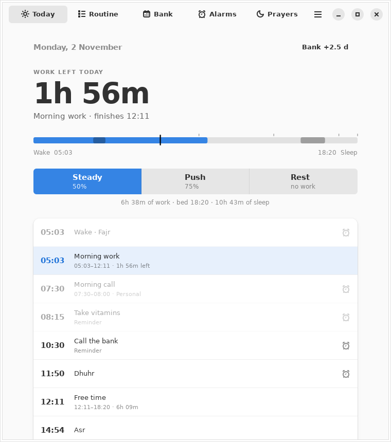
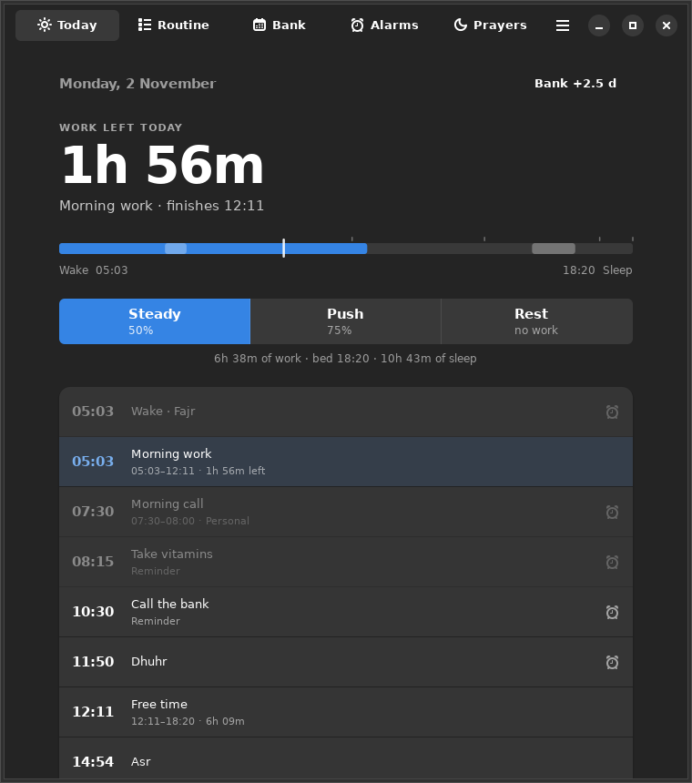

<p align="center"></p>

<h1 align="center">Fuzzy Journey</h1>
<p align="center"><b>A calmer daily rhythm.</b><br>Your day, shaped around prayer and focused work.</p>

<p align="center"> </p>

> **The day is given.**
> **Work a share.**
> **Bank the rest.**
> **Protect the night.**

Fuzzy Journey is a small, quiet desktop app for GNOME. It plans each day from the prayer times of your city, tells you how much work is left, banks the rest you earn, and rings your alarms, all offline, with no account.

## The idea

| | |
|---|---|
| **The day is given.** | Fajr to Isha is your day. Prayer times, not arbitrary hours, set its edges, so long summer days and short winter days both stay in proportion. |
| **Work a share.** | Give work a share of the day, not a number of hours: **Steady** 50%, **Push** 75%. Work fills the morning first, until 14:00. The afternoon stays yours; the evening is only for overflow. |
| **Bank the rest.** | Each Push day banks half a day. Each Rest day spends a whole one. Two Push days buy one Rest day. The balance may go negative, but you always see it. |
| **Protect the night.** | Sleep is measured against the natural night, Isha to the next Fajr. Evening work is the last resort, and its cost is shown as sleep given up. |

Two practices keep it honest: **count focus, not clock time** (a call pauses the work clock; the finish moves later, the work stays whole) and **keep it yours** (everything stays on this computer; alarms ring without internet).

Read the full version, with worked examples, in [PHILOSOPHY.md](PHILOSOPHY.md). The app shows it on first launch and under **Menu → Philosophy**.

## Install

Requires Ubuntu 24.04+ (or any GNOME system with GTK 4 and libadwaita 1.4+) and systemd.

```bash
sudo apt install python3-gi gir1.2-gtk-4.0 gir1.2-adw-1 libnotify-bin   # once
git clone https://github.com/aryan-nikzad/fuzzy-journey && cd fuzzy-journey
./install.sh
```

Open **Fuzzy Journey** from the applications menu. Re-run `./install.sh` any time to update; `./uninstall.sh` removes the app and keeps your data. For your own MP3/OGG alarm sounds, also `sudo apt install mpv`.

To try it without installing: `./run.sh`.

## Using it

| Screen | What it is for |
|---|---|
| **Today** | How much work is left, the shape of the day from wake to sleep, and a timeline of everything coming. Choose Steady, Push or Rest in one tap. |
| **Routine** | Your activities (calls, gym, meals, a custom wake or sleep time), when evening work starts, and what each kind of day would ask of you today. |
| **Bank** | Your balance of rest, and a calendar to mark Push and Rest days, today or in the past. |
| **Alarms** | Reminders, prayer alarms that follow the timetable, and whether the alarm service is running. |
| **Prayers** | The timetable for the year. |

Shortcuts: `Ctrl+1`…`Ctrl+5` switch screens, `Ctrl+,` preferences, `F1` philosophy, `Ctrl+Q` quit.

**First launch:** the app ships with the 2026 timetable for Shahrekord. For another place or year, open **Menu → Preferences**, set your location, and download the timetable. That is the only time the internet is needed.

## How a day is computed

For January 1st in Shahrekord (Fajr 05:42, Isha 18:20, so the day is 12 h 38 min):

| | Work | Blocks | Bed | Sleep given up |
|---|---|---|---|---|
| **Steady 50%** | 6 h 19 min | 05:42-12:01 | 18:20 | none |
| **Push 75%** | 9 h 28 min | 05:42-14:00, then 18:00-19:10 | 19:10 | 50 min |
| **Rest** | none | none | 18:20 | none |

A 07:30-08:00 call during Steady work moves the finish from 12:01 to 12:31. The work is still 6 h 19 min. Personal *Wake* and *Sleep* activities override the Fajr and Isha defaults.

## Command line

The original planner is still here, with the same flags and output:

```bash
python3 prayer_aio.py --today                  # today's plan
python3 prayer_aio.py --75 --tomorrow          # only the 75% plan, tomorrow
python3 prayer_aio.py --flex-time 00:30        # add half an hour of work every day
python3 prayer_aio.py --year 2027 --evening-start 19:30 --no-show
```

After install it is also available as `fuzzy-journey-planner`. Run it with `--help` for everything.

## Your data

Everything lives in `~/.local/share/fuzzy-journey/`: one SQLite file (alarms, activities, day marks, settings) and the downloaded timetables as CSV. Replaced timetables are backed up to `backup/` first. There is no account, no analytics and no sync. Updating from version 1 keeps all your data.

## Development

```bash
make test        # unit tests (no GTK needed)
make test-ui     # GUI smoke tests, headless via xvfb
make lint
make screenshots # regenerate docs/screenshots
```

See [CONTRIBUTING.md](CONTRIBUTING.md) for the architecture and [AGENTS.md](AGENTS.md) for the rules that must not break. MIT licensed.
